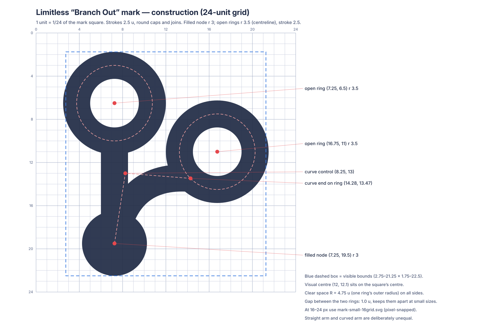

# Klados brand: the "Branch Out" mark

Chosen 27 Nov 2026. Source files: `svg/`. Regenerate everything with `source/build.py` (see "Swapping the name").

## Meaning

**From where you stand, more than one next step is open.** The filled dot is where the learner is now; the two open rings are next steps, and they are never closed or filled.

Filled versus open carries the meaning. Colour never does.

## Construction

- 24 × 24 unit square. 1 unit = 1/24 of the square.
- Filled node: centre (7.25, 19.5), radius 3.
- Open ring 1 (straight arm): centre (7.25, 6.5), radius 3.5 on the stroke centreline, stroke 2.5.
- Open ring 2 (curved arm): centre (16.75, 11), radius 3.5, stroke 2.5.
- Straight arm: from the node centre up to the edge of ring 1 (y = 10).
- Curved arm: quadratic curve from the node centre, control (8.25, 13), ending on ring 2's centreline at (14.28, 13.47).
- All strokes 2.5 units, round caps and round joins. No arrowheads.
- The two arms are deliberately unequal: one straight and short, one curved and reaching further.
- Visible bounds: x 2.75–21.25, y 1.75–22.5. The visual centre (12, 12.1) sits on the square's centre.
- **Small-size master** (`svg/mark-small-16grid-*.svg`) is drawn on a 16-unit grid for 16–24 px: the stem snaps to whole pixels, ring holes stay 3 px wide and the curved arm is thinner, so the shape doesn't clog. Use it for favicons and anything 24 px or smaller. Use the main mark from 32 px up.

## Clear space

Keep empty space of at least **R** on every side of the mark's visible edge, where R = 4.75 units, the outer radius of one ring (about one fifth of the mark's height). For lockups, measure R from the mark at the size it is used and keep it around the whole lockup.

## Minimum sizes

| Item | Screen | Print (suggested) |
|---|---|---|
| Mark | 16 px (use the small-size master at 16–24 px) | 6 mm high |
| Horizontal lockup | 20 px high | 6 mm high |
| Stacked lockup | 48 px high | 14 mm high |

Below these sizes, use the mark on its own.

## Colours

One ink. The accent is optional and goes **only on the open rings**. Never use colour to mean something the shape doesn't already say.

| Role | Hex | RGB | Use |
|---|---|---|---|
| Ink | `#1F2A44` | 31, 42, 68 | Default mark and text on light backgrounds |
| Inverse | `#F4F6FB` | 244, 246, 251 | Mark and text on dark backgrounds; light page background |
| Accent (optional) | `#3B7BE0` | 59, 123, 224 | Open rings only |

Measured WCAG contrast ratios (full table in `CHECKS.md`):

| Pair | Ratio | Needs |
|---|---|---|
| Ink on white | 14.26:1 | 3:1 |
| Inverse on ink | 13.19:1 | 3:1 |
| Inverse on GitHub dark `#0D1117` | 17.50:1 | 3:1 |
| Accent on white | 4.12:1 | 3:1 |
| Accent on inverse `#F4F6FB` | 3.81:1 | 3:1 |
| Accent on ink | 3.46:1 | 3:1 |
| Accent on GitHub dark `#0D1117` | 4.59:1 | 3:1 |

Ink on a dark background (1.33:1 on `#0D1117`) fails, so on dark backgrounds always switch to the inverse files.

Black (`#000000`) and white (`#FFFFFF`) one-colour versions exist for print, stamps, engraving, embroidery and screen printing.

## Typography

- Wordmark: **Inter SemiBold (600)**, optical size 32, tracking −1%. Cap height = 10 units next to the 24-unit mark.
- Indic scripts: **Noto Sans Malayalam**, **Noto Sans Devanagari** and other Noto Sans families, SemiBold, sized to match the Latin wordmark by eye.
- All fonts are under the SIL Open Font License.
- Samples: `svg/lockup-horizontal-malayalam-sample-ink.svg` (ക്ലാഡോസ്) and `svg/lockup-horizontal-devanagari-sample-ink.svg` (क्लाडोस). These are phonetic transliterations for testing; have a native reader confirm the spelling before using them publicly.

## Lockups

- **Horizontal:** mark, then the name to its right; name centred on the mark's visual centre; gap of 6.25 units between the mark's edge and the text.
- **Stacked:** mark centred above the name; name cap height 6.5 units.
- The mark and the name are **separate elements**. In outlined files the name is one `<path>` and the mark is its own `<g>`. Editable versions with live text are in `svg/editable/`.
- Use the outlined files in production. Live-text files can render slightly wider in tools that pick Inter's optical size automatically.

## Do

- Use the files as supplied, scaled proportionally.
- Use ink on light backgrounds and inverse on dark backgrounds.
- Keep the clear space and minimum sizes.
- Use the small-size master at 16–24 px.
- Use the accent, if at all, on both rings at once.

## Don't

- Don't rotate, mirror, skew or stretch the mark.
- Don't add arrows or arrowheads to the arms.
- Don't turn it into, or combine it with, an infinity sign or a loop.
- Don't fill the rings. Open rings are the point.
- Don't hollow out the filled dot.
- Don't recolour parts to carry meaning (e.g. green/red, "done/not done").
- Don't use the accent on the dot or the arms.
- Don't add outlines, shadows, gradients or glows.
- Don't put the ink mark on dark or busy backgrounds.
- Don't add or remove rings or arms, or make the arms equal.
- Don't place religious, national-flag or other symbols inside or around it.

## Swapping the name

The mark has no name inside it, so a rename only touches the lockups and a few text files.

1. Run `LIMITLESS_NAME="NewName" python3 source/build.py` (needs `rsvg-convert`, `svgo`, Python with `fonttools`, `uharfbuzz` and `Pillow`, and the Inter and Noto font files; set `FONT_DIR` if they live elsewhere). This rewrites the lockups, the cards, the manifest and every icon. The mark files come out unchanged.
2. Or edit the text in `svg/editable/*.svg`, then convert the text to outlines (Inkscape: Path → Object to Path) and export.
3. Update `web/site.webmanifest`, the `og:image:alt` text in `web/head-snippet.html`, and these docs.
